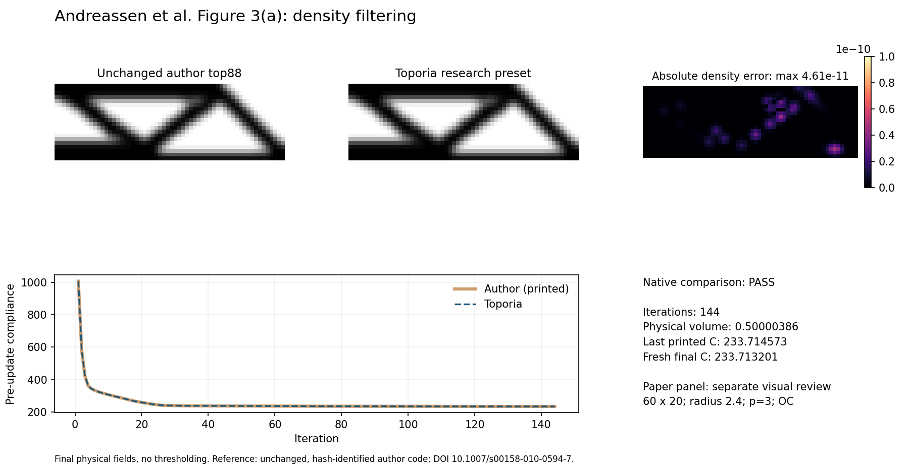
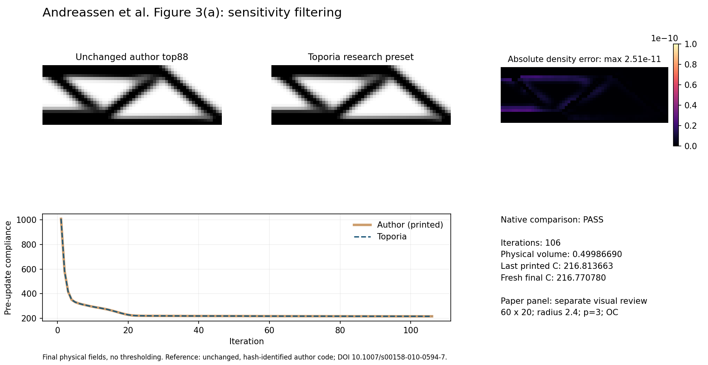
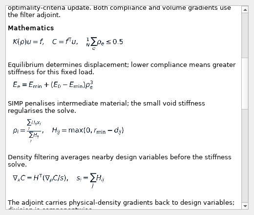

# Batch 1: foundation and baseline examples

Branch: `feature/research-presets-v022`, based on `integration/physics`.
The colleague's GUI checkout was inspected only. No new numerical algorithms,
objective/constraint semantics or executable workflow framework were introduced.

## Delivered

- [Core computation guide](core.html), with [editable Markdown](core.md), a
  forward/backward diagram, typeset mathematics and links to implementation.
- [Coverage census](coverage.md): 88 selectable functions plus 9 physics engines;
  presets are counted separately (18 existing plus 2 research recipes).
- Consistent [evidence conventions](conventions.md), reusable preset/researcher
  templates and a persistent [to-fix queue](to-fix/README.md).
- Two GUI-selectable Figure 3(a) presets with explanations, equations, symbols,
  limits and rerun instructions, opened by the existing preset **?**.
- An unchanged-author-code capture, reproducible Python comparison driver,
  regression checks and [GUI handoff](gui-handoff.md).

## First paper targets

[Andreassen et al. (2011)](https://doi.org/10.1007/s00158-010-0594-7),
Figure 3(a), top and bottom panels. Panel identification and qualitative visual
review use the [author-hosted uncorrected manuscript](https://www.topopt.mek.dtu.dk/-/media/subsites/topopt/apps/dokumenter-og-filer-til-apps/topopt88.pdf),
page 7. Its source hash and review scope are recorded in
[paper-review.json](evidence/paper-review.json). The manuscript figure is linked,
not redistributed here. No published compliance annotation is asserted.

Both setups use 60 by 20 square plane-stress Q4 cells, normalized E0=1,
Emin=1e-9, nu=0.3, downward unit top-left force, left horizontal symmetry,
bottom-right vertical roller, initial density 0.5, SIMP p=3, radius 2.4,
OC move 0.2 and change tolerance 0.01. A 200-step safety cap is unused.
The general MBB preset keeps its original radius/default settings.

| Recipe | Steps | Last pre-update C | Fresh final C | Physical fraction | Max density difference from author |
| :-- | --: | --: | --: | --: | --: |
| Density | 144 | 233.714573 | 233.713201 | 0.50000386 | 4.61e-11 |
| Sensitivity | 106 | 216.813663 | 216.770780 | 0.49986690 | 2.51e-11 |

Both native comparisons pass the [declared tolerances](conventions.md), including
every printed compliance sample and identical stopping counts. The density case
slightly exceeds the mathematical 0.5 budget by about 3.86e-6, as does the author
run; numerical agreement is not an exact feasibility certificate.



[Density description with math](presets/top88-density.html) ·
[Full density report](evidence/top88-density.json)



[Sensitivity description with math](presets/top88-sensitivity.html) ·
[Full sensitivity report](evidence/top88-sensitivity.json)

Native-code agreement is quantitative. The paper-panel match is a separately
reviewed qualitative match of topology and grey features to the identified
manuscript panels. It is not pixel equality, an independent published numerical
benchmark, or a reproduction of every cited reference for these functions.

The shared examples exercise `model:q4`, `physics:q4_plane_stress`,
`representation:element_density`, `filter:density`, `filter:sensitivity`,
`interpolation:simp`, `response:compliance`, and `updater:oc`. Other functions
remain pending. In particular the built-in volume budget does **not** exercise
the separate `response:volume` minimum-volume objective, which remains pending.

## How to inspect in the GUI

Start Toporia from this checkout, select either `Paper: top88 Fig. 3(a)` preset,
and click the preset's existing **?**. The help contains the setup and function
explanation, then equation images with plain-language explanations, symbols,
paper target, limitations and reproduction command. No network/TeX is used.



The offscreen QA process registers Matplotlib's bundled DejaVu Sans font because
the Windows sandbox's offscreen Qt plugin lacks normal system fonts. This is a
preview-only setting; it does not change the application's appearance settings.

## Verification

The focused checks verify native-field/trajectory agreement, declared coordinate
conversion, failed-match detection, preset settings, inventory identities and
Qt loading each actual equation image. Existing GUI regression, independent
reference and golden numerical checks are also run. See the final validation
record below for measured outcomes.

| Check set | Final outcome |
| :-- | :-- |
| Existing GUI regression cases | 864 passed across the broad run and targeted reruns |
| Research preset/help checks | 10 passed |
| Existing original-reference checks | 7 passed |
| Existing golden numerical cases | 16 passed; stored baselines unchanged |
| Ruff and patch whitespace checks | Passed |

Total: **897 distinct checks passed**. The broad GUI invocation initially had
25 setup errors from the sandbox's unwritable default temporary directory.
Those cases were rerun with workspace-local temporary storage. Two older
shared-window tests also needed fresh-process reruns to avoid state retained by
the selectively executed 3-D case; both passed in isolation. This is an existing
test-isolation caveat, not a numerical solver change in this batch.

```powershell
python -m experiments.research_figures
python -m experiments.research_inventory
python -m experiments.research_docs
python -m experiments.research_preview
python -m pytest tests/apps/test_gui.py tests/apps/test_research_help.py tests/plugins/test_research_figures.py
python -m pytest tests/checks/test_original_references.py tests/golden/test_golden.py
```

`research_docs` uses the documentation-only `markdown-it-py` package already
available in the development environment. Application help and reproduction
drivers require only the normal project dependencies. On a restricted Windows
runner, point process-local TEMP/TMP and pytest's `--basetemp` at a writable
workspace output directory; do not change source or regenerate golden baselines
to work around a temporary-directory permission error.

## Remaining work

Batches 2-4 add figures and mathematical descriptions alongside each relevant
function. Current pending targets stay explicit in the census. Later GUI work
can add benchmark-card Description / Math actions, function-to-preset links,
status badges and comparison links. No failed paper reproduction remains in
the tracked to-fix queue from these two attempts; an initial row-orientation
mismatch was resolved by the documented coordinate conversion.
