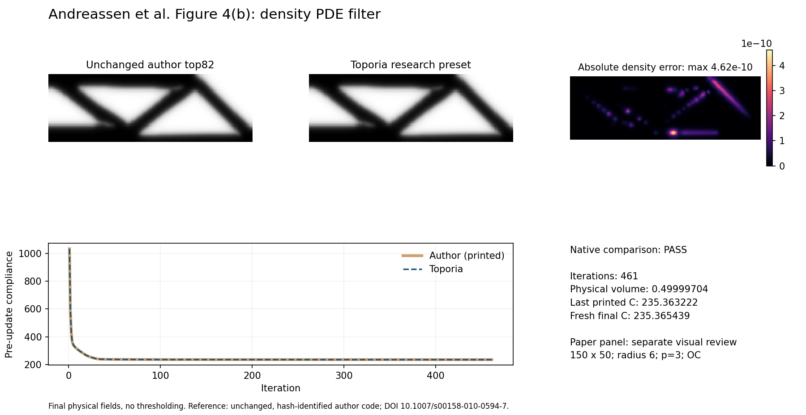
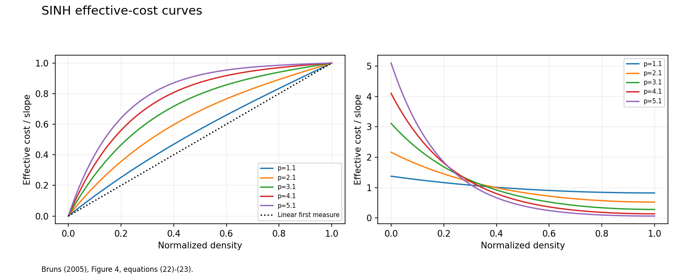
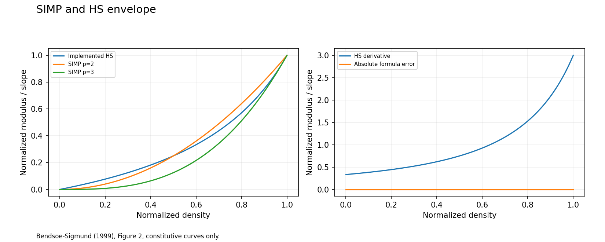
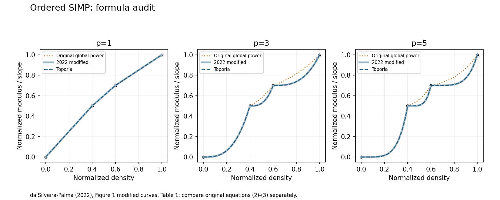

# Batch 2: filters, material laws and continuation

Branch: `feature/research-presets-v022`. This batch adds **21 figure
demonstrations for 20 numerical functions**, **20 registered companion presets**,
and a quarantined volume-preserving-projection recipe. The numerical algorithms
and framework contracts are unchanged. The colleague's GUI checkout is untouched.

[Visual gallery](evidence/batch2/index.html) · [All cases](batch-2-cases.md) ·
[Function coverage](coverage.md) · [Source reviews](evidence/batch2/paper-reviews.json)

## What matches research

| Function | Identified target | Quantitative evidence | Scope |
| :-- | :-- | :-- | :-- |
| PDE density filter | Andreassen et al. Figure 4(b), bottom | Same 461 stopping steps; max density difference 4.62e-10; all printed compliance samples within 4.992e-5 | Unchanged author top82 plus a separate qualitative manuscript-panel review |
| SINH | Bruns Figure 4 | Resource-curve error below 6.7e-16 for p=1.1,2.1,3.1,4.1,5.1 | Density measures, not the paper's optimized topologies |
| HS upper envelope | Bendsøe-Sigmund Figure 2 | Max curve error below 5.6e-17 at nu=1/3 | Constitutive curves, without microstructure insets |
| Interval-local ordered SIMP | da Silveira-Palma Figure 1, modified curves and Table 1 | Max error 5.1e-10, tolerance 1e-8 | Increasing-modulus stiffness branch; no cost model or optimizer reproduction |



The PDE preset uses 150 by 50 cells, radius 6 and a safety cap of 800. The
corrected author top82 refuses radii below 2.5, so the coarsest paper panel is
not silently substituted. Toporia uses a 60 by 20 normalized domain at resolution
2.5; uniform 2-D rescaling with unit thickness leaves this square-element
stiffness problem unchanged. Its fresh final compliance is **235.365439** and
physical fraction **0.49999704**. The last printed pre-update compliance is
**235.363222**; it is not the fresh final value.

The unchanged author source, its SHA-256 and MATLAB version are recorded in
[`paper_top82.json`](../../tests/references/paper_top82.json). The field comparison
uses the same declared top-down to bottom-up row conversion as Batch 1.
No author code or downloaded paper is bundled in the repository.





## Ordered-SIMP attribution correction

The existing implementation uses a power of the **local interval coordinate**.
It matches the increasing-modulus branch of da Silveira and Palma (2022), rather
than Zuo and Saitou's original global-power expression. At the published material
knots, the maximum difference from the original expression is about **0.07935**
for p=3 and **0.09627** for p=5. The p=1 curves coincide within soft-phase
regularization error.



The plugin reference and catalogue now identify the formula actually implemented.
No numerical behavior was changed. Reproducing the original 2017 expression is
kept as a [separate unresolved target](to-fix/batch2-ordered_simp/README.md).
The 2022 primary text/table were available through the web tool, but direct PDF
download returned HTTP 403; no visual image match is claimed for that paper.

## What remains to fix

**17 of the 21 paper comparisons remain unresolved**, even where their ordinary
numerical checks pass. Every case has a generated figure, a mathematical
description, explicit parameters, an evidence report and a next check. The
[case index](batch-2-cases.md) links them individually.

- Directional PDE: independently verified cosine mode; a different discretization from the cited nodal source.
- Fixed and volume-preserving projection: equation/root checks exist; original figure inputs and full comparisons remain incomplete.
- Morphology: all four operations are demonstrated; the source bitmap and uniform structuring element differ from the diagnostic cone-weighted example.
- AM, casting, machining and self-support: formulation, geometry, discretization or tool-model differences remain explicit.
- Symmetry, routing, extrusion and pattern: controlled operator demonstrations do not establish the cited optimized designs.
- RAMP: rational evaluations agree; a numbered source figure and its parameter grid were not recovered.
- Continuation: clock/event rules agree with independent simulations, but the paper's optimization histories are not reproduced.

The [to-fix queue](to-fix/README.md) contains 17 unresolved case records plus the
separate original-2017 ordered-SIMP target. These are evidence gaps or known
variant differences, not silently successful paper reproductions.

## A real numerical failure was quarantined

Volume-preserving projection has a global implicit-threshold adjoint. On an
all-solid field its threshold-derivative denominator can become zero, producing
a non-finite gradient. Smooth-field finite differences and a nonuniform
volume-preserving root check had passed; those were insufficient to establish
compatibility with discrete updates in GUI Compare Methods.

**Resolved 28 October 2026.** At a design whose every element is exactly 0 or 1,
every threshold preserves the volume, so the threshold is not defined. For a
uniform (all-solid or all-void) design the derivative is the identity: any
admissible perturbation is absorbed by the perturbed elements themselves, which
one-sided finite differences confirm. For a mixed 0/1 design the first-order
response depends on the perturbation direction, so no gradient exists; the
filter now stops with an explicit error, and 0/1-only updaters (TOBS, hard-kill
BESO) are refused when the projection is the first filter. Exactly-binary
elements contribute exactly zero to the denominator. No epsilon was added. The
companion is registered again; its [paper comparison](to-fix/batch2-heaviside_volume/README.md)
remains open.

## Continuation companions are bounded observations

All four schedule rules pass independent clock/event checks. Actual companion
optimizations also run through the existing engine, with parameter histories
saved separately from the synthetic event diagnostic.

| Companion | Steps | Last pre-update compliance | Final physical fraction | End state |
| :-- | --: | --: | --: | :-- |
| Equal steps | 200 | 240.0463 | 0.49997867 | Iteration cap |
| Linear ramp | 200 | 240.0395 | 0.49997440 | Iteration cap |
| Geometric beta | 450 | 3.3520e8 | 0.49999423 | Iteration cap; poor sharp-projection behavior |
| Settled beta | 450 | 1227.3681 | 0.50000010 | Iteration cap; oscillatory behavior |

These are not converged recommendations. In particular, the source paper's
optimizer and early-convergence triggers must be aligned before asserting a
trajectory match. The sharp OC companions remain in the to-fix evidence.

## GUI use and reproduction

Select a registered **Research:** preset and click its existing **?** for the
function explanation, typeset equations, symbols, source and limitations.
**GUI Run executes its ordinary optimization companion.** Transfer/constitutive
figures are generated by the command in its help and can be opened in the gallery.
This distinction avoids introducing a new GUI execution framework in this batch.

```powershell
python -m experiments.research_batch2 --case sinh
python -m experiments.research_batch2 --case pde
python -m experiments.research_batch2 --companions
python -m experiments.research_capture --source-dir PATH --matlab-exe PATH
python -m experiments.research_publish
python -m experiments.research_inventory
```

The all-case command completes its reports and then exits nonzero for the known
quarantined saturation failure. `--strict-paper` additionally treats unresolved
paper targets as failures. `--cached-pde FILE` is explicitly a report/plot review
of a prior solve, not a fresh optimization. Fresh PDE execution and fresh native
capture were both performed for this batch. MATLAB preferences were temporary.

## Verification

**247 distinct checks passed** across the recorded selections: 226 focused
research/help, relevant filter/material/schedule regressions and unchanged golden
checks; 20 GUI-to-comparison cases; one recipe-isolation check. The final help
rendering check also passed for every registered scientific description.

The known saturation failure is asserted as a documented quarantined defect,
not counted as a successful numerical reproduction. Ruff, documentation links,
source/image review and patch whitespace are checked separately. Existing
golden baselines were not regenerated.
