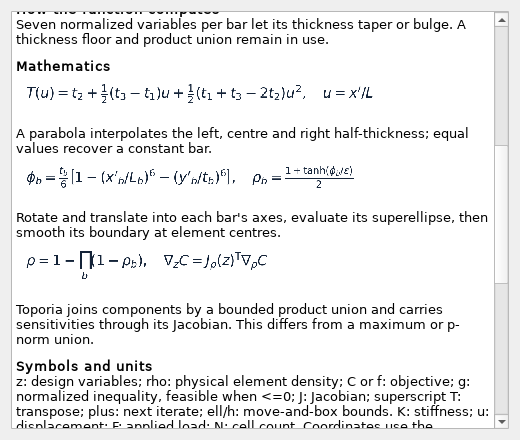
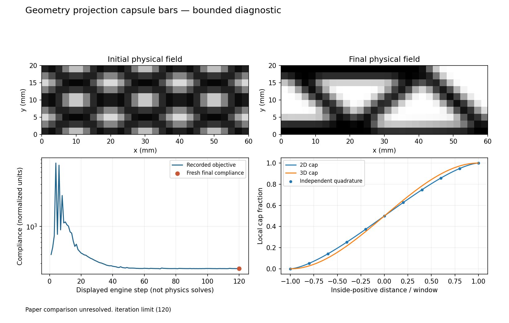
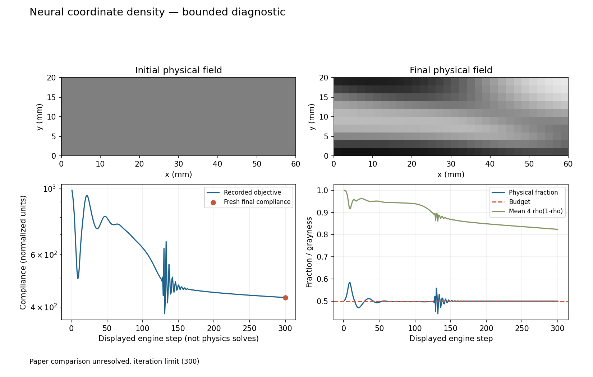
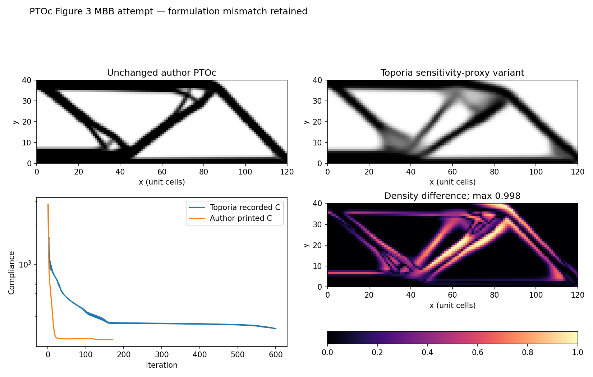

# Batch 3: updaters, representations and level sets

Branch: `feature/research-presets-v022`. This batch adds **31 registered research
companions for 30 existing numerical functions** and 32 figure artifacts: 22 remaining updaters, five
additional representations, a second MMC thickness variant, and three standalone
level-set methods. OC and element densities reuse the verified Batch 1 examples.
The numerical algorithms and framework contracts are unchanged; the colleague's
GUI checkout is untouched.

[Figure gallery](evidence/batch3/index.html) · [All cases](batch-3-cases.md) ·
[Visual mathematical guide](optimization.html) ([source](optimization.md)) ·
[Source reviews](evidence/batch3/paper-reviews.json) · [Function census](coverage.md)

## What was executed and documented

Every companion has initial/final physical fields, a recorded objective history,
a fresh final compliance, physical-volume/grayness measurements, stopping reason,
library versions and the resolved method parameters. Saved variables retain the
actual geometric/spline/network parameters. The existing preset **?** displays
the function explanation, typeset equations, symbols, source target, differences
and rerun command. The same description is exported as standalone HTML.



The common diagnostic uses a 60 by 20 half-MBB domain with 60 by 20 cells
(28 October 2026; previously 30 by 10 with a fixed 120-step cap), physical
density filtering with radius 1.5 cells and SIMP p=3, and runs until the design
change falls below 0.01 or 300 steps. Evolutionary, integer and stochastic
updaters (BESO, hard-kill BESO, TOBS, Adam) report zero change after one step,
so they use their own criterion or the cap. The dense SLSQP, trust-constr and
null-space companions use 30 by 10 cells (SciPy SLSQP takes minutes at 60 by 20).
Standalone level sets use their own representation/volume control and linear
p=1 ersatz stiffness. Different representations and laws still preclude treating
the gallery as a fair optimizer ranking; the four MMA implementations agree at
compliance 210.66-211.55. Exact settings are in every report.



## Independent numerical evidence

| Check | Recorded outcome | What it establishes |
| :-- | :-- | :-- |
| Five directional adjoint checks for each of six representation variants | All below 2e-5 relative/absolute-normalized tolerance | Smooth-field Jacobian consistency; not derivatives at switches/saturation |
| Cubic B-spline evaluation versus separate scalar Cox-de Boor recursion | Max field error 2.23e-16 | Basis/ordering and partition-of-unity consistency |
| Disk/sphere cap projection versus independent cross-section quadrature | Max error 1.09e-13 | The local flat-interface projection geometry |
| Adam versus a separate Algorithm 1 moment recurrence | Max state error 1.12e-16 | Inactive-budget, fixed-gradient recurrence; not paper learning curves |
| SiMPL first step versus an independent scalar root solve | Max density error 8.70e-12 | A controlled instance of the source's primal/latent construction |
| Directional checks at every saved final design (Batch 3 and 4, [report](evidence/gradients/report.json)) | 42 pass, worst best-step error 5.8e-6; BESO, hard-kill BESO and TOBS end with every element solid or void, so no two-sided derivative exists | Derivatives at the nearly black-and-white end state, interior variables only; `python -m experiments.research_gradients` |
| Fresh physics on all 31 saved final fields | Agreement with recorded final compliance within 1e-9 relative tolerance | Report/field consistency, without applying the filters twice |

Every executed field and objective history is finite and its densities are
bounded. Most other updater cases have execution/regression evidence, **not**
an independent reference implementation of their update algorithm. The report's
`checks.scope` records that distinction.

## Paper reproductions remain unresolved

**No new full paper figure reproduction is certified in this batch.** All 31
cases have individual [to-fix records](to-fix/README.md), with the exact source
gap or implementation difference and a next check. The census distinguishes
these attempted diagnostics from untouched work: 39 numerical functions remain
pending, 46 have unresolved paper comparisons, eight have the Batch 1 baseline
example and four have the matched Batch 2 targets.

Source review includes the SiMPL Figure 1 schematic, Guo's Figure 8 component
diagram, the geometry-projection equations and PTO's complete paper/supplement.
The independently checked constructions use explicitly declared own coordinates
or quadrature; they do not become pixel matches to the source diagrams. Other
sources have only a publisher preview, library documentation or incomplete
access/setup. Per-case reviews state which was available.

The important formulation gaps are concrete:

- **MMC/MMV:** product unions and tanh/centre sampling differ from reference maximum/projection rules; the current MMV is 2D superelliptical holes rather than the source's 3D B-spline void surfaces.
- **Neural fields:** tanh/sigmoid with Adam-AL differs from TOuNN's batch-normalized LeakyReLU/AMSGrad. The bounded example remains gray.
- **SiMPL:** gradient normalization and step adaptation differ from the source SiMPL-A/B optimization histories.
- **PTO:** filtered negative sensitivity is a different allocation quantity from source element compliance; redistribution/filter ordering also differs.
- **Level sets:** RBF normalization/clipping, HJ scaling/feedback, and cell-centred reaction-diffusion/bisection are declared variants, not exact source ports.
- **Library optimizers:** an installed library call and similar MBB compliance do not reproduce its original source-paper examples.

## Feasibility and stopping are separate from execution

On the 60 by 20 showcases (28 October 2026) one companion exceeds the 0.5
volume budget by more than the absolute tolerance 1e-4: variable-thickness MMC
at 0.503301 (geometric-variable MMA overshoot). On the earlier 30 by 10 runs
Adam-AL, local-stress AL, both MMC variants, MMV and the RBF level set did.

The multi-OC and local-stress companions use a stress limit of 1.5, 0.8 times
the compliance design's peak relaxed stress (1.88), so the limit must reshape the
design. Both meet it and the volume budget: multi-OC at 0.08% under the limit with
move 0.02 (it ends 0.3% over at move 0.05, as expected for OC with a sign-changing
stress gradient), local-stress AL 0.16% under, at 3% more compliance. The earlier
limit of 0.5 (0.27 times the peak) cannot be met with half the material at a
point load. L-bracket (local stress) is a separate preset: it lowers the corner
peak from 0.673 to 0.514 with 26% material and ends about 3% over its limit of
0.5, whatever the step count, penalty or limit; its re-entrant corner stress is
singular (14% over on a twice finer mesh).

B-spline uses 40 by 14 quadratic coefficients with a Heaviside projection
sharpened to beta 32 (greyness 0.0007, compliance 191; with 8 by 4 cubic
coefficients it stayed at greyness 0.87). The neural field uses three 40-wide
layers and, as in TOuNN, a SIMP penalty rising from 1 to 8, with a projection
behind the density filter (greyness 0.04 after 600 steps; 0.74 before).

Five companions stop at their step cap (300, or 600 for the neural field); twenty-six report the design-change
tolerance, their own stopping criterion or a library finish flag. Neither category establishes
global optimality or a paper match. Final grayness is recorded alongside volume and compliance rather than
concealed by thresholding.



## PTOc Figure 3: native comparison

The [separate comparison](evidence/batch3/pto/paper-attempt/report.json) uses the
unchanged PLOS S2 author source identified by SHA-256 in
[`paper_ptoc.json`](../../tests/references/paper_ptoc.json). It is a **120 by 40**
MBB beam with fraction **0.35**, SIMP p=3, filter radius 1.5 and history alpha=0.5.
The downward unit force is split over `(0,40)`, `(1,40)`, `(2,40)`; vertical
rollers lie at `(120,0)`, `(120,1)`, `(120,2)`, with left horizontal symmetry.
The first printed infinite change is retained as JSON null; all 170 source
iterations and the final field are captured. MATLAB preferences are temporary.

The Toporia attempt aligns q=1, relax=0.5 and move=1 where possible, but keeps
the existing sensitivity-proxy allocation. The driver first checks the author
field against its printed compliance, so a load/support/material mapping error
cannot be mistaken for an optimizer difference. It then preserves the numerical
mismatch instead of changing the algorithm to force agreement.



The author-field physics check gives **266.609374**, consistent with the printed
**266.61**. The Toporia variant reaches **323.297382** at the 600-step cap,
**21.26% higher compliance**, with maximum density difference **0.99846**.
This is a failed reproduction of `pto`, even though both fields meet fraction 0.35.

**Resolved 28 October 2026 by a separate updater.** `ptoc` implements the published
algorithm (allocation by element compliance, its own filter on each increment,
history blend). The preset **Paper: PTOc Fig. 3 (MBB)** matches all 169 printed
compliances to the printed two decimals and the author's final field to 8.6e-9
([evidence](evidence/batch3/ptoc/report.json)). `pto` stays a declared
sensitivity-proxy variant; the rest of this section documents its difference.
Exact final values and stopping counts are in the linked report. The original
source code and downloaded manuscripts are not redistributed. The updater's
comments/reference now identify the proxy variant and remove the incorrect
claim that the allocations or filter order were interchangeable; arithmetic
and GUI controls are unchanged.

## Core framework and GUI handoff

The [optimization guide](optimization.html) explains the design-variable
Jacobian, `Evaluation`, normalized constraints, free-variable adapter, external
optimizer lifecycle and the existing engine loop. The [module map](modules.md)
lists supporting modules separately from selectable numerical functions.

There are now **71 presets**: 18 original and 53 registered research recipes.
The 97-function/engine count is unchanged. The new GUI framework can reuse
stable IDs, parameters, compatibility checks and plain descriptions. General
nested execution still needs explicit variable/field ownership, branch-gradient
combination and cache/lifecycle rules; no replacement graph executor, new
objectives or physics adapters were added. See the [GUI handoff](gui-handoff.md).

## Reproduction and verification

```powershell
python -m experiments.research_batch3
python -m experiments.research_batch3 --case mmc
python -m experiments.research_batch3 --render-only
python -m experiments.research_pto_attempt
python -m experiments.research_publish3 --pto-attempt results/research/batch3/pto-paper-attempt
python -m experiments.research_inventory
python -m experiments.research_docs
```

The default Batch 3 command reports finite execution/numerical checks; use
`--strict-paper` to exit nonzero for unresolved source reproductions. The PTOc
attempt exits nonzero when it does not match. `--render-only` reviews existing
saved evidence and does not perform a fresh solve. The publisher rejects
shortened test captures, failed checks and uncertified paper-match claims.

**374 distinct checks passed:** 142 existing representation/updater/stress and
golden checks; 180 research, level-set and actual Qt math-resource checks; 51
GUI-to-comparison cases; and the final native PTO provenance/mismatch check.
Golden baselines were not regenerated. Ruff, patch whitespace, local links,
source diagrams, generated plots and real help-window previews were reviewed
separately. A SciPy quasi-Newton warning about a locally linear gradient is
retained in the logs; no numerical warning from Toporia was suppressed.

The 374 passing checks do not count unresolved paper matches as successes.
