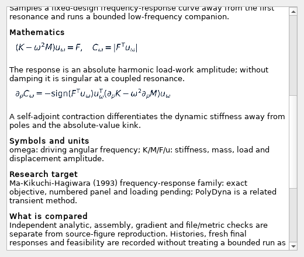
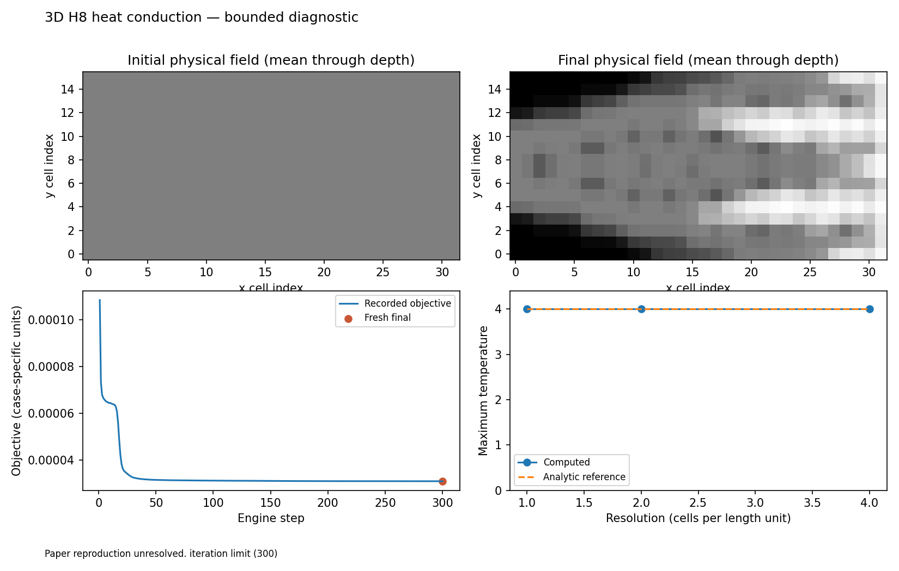
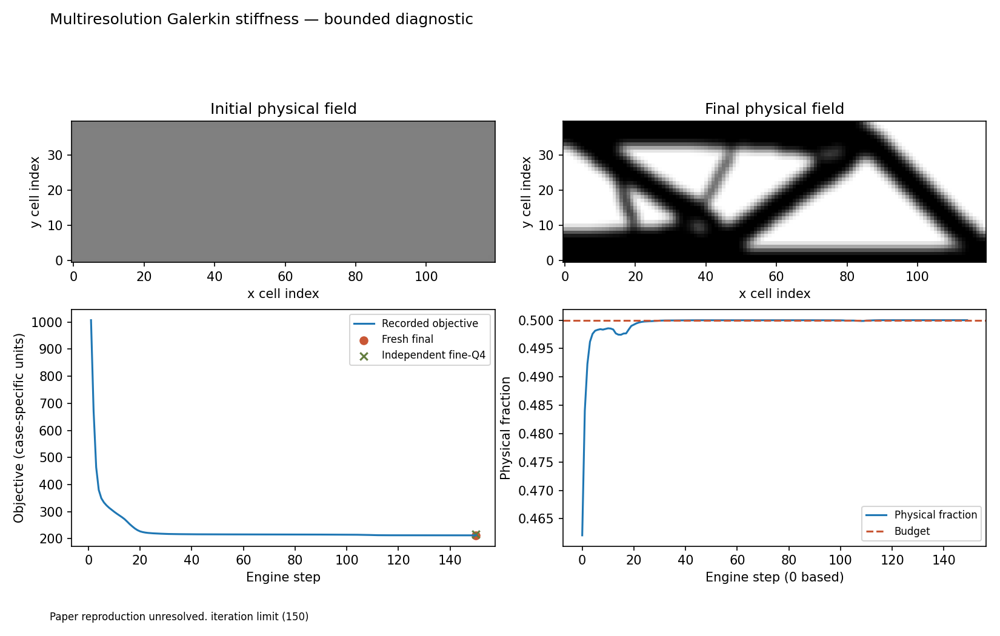
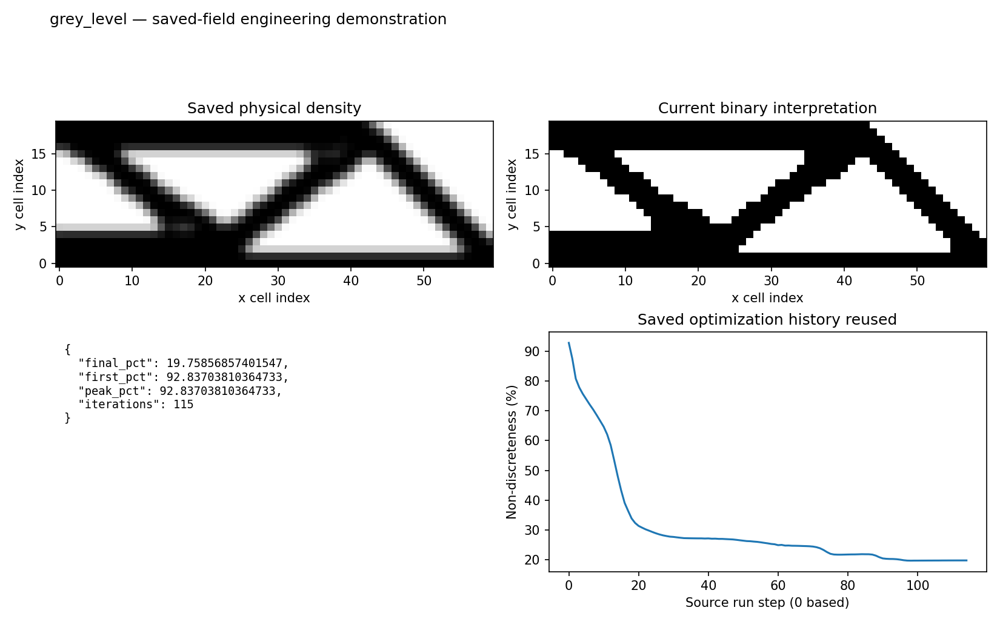

# Batch 4: physics, responses, post-processing and framework assessment

Branch: `feature/research-presets-v022`. This batch adds **19 registered presets**
and **25 demonstrations** covering the remaining **39 numerical functions**.
Related models, physics engines and responses share examples; seven 2D
post-processors and STL export reuse saved fields instead of repeating their
optimizations. The numerical algorithms and GUI framework are unchanged.

[Gallery](evidence/batch4/index.html) · [All cases](batch-4-cases.md) ·
[Function census](coverage.md) · [Framework assessment](framework-assessment.html)
([editable source](framework-assessment.md)) · [Source reviews](evidence/batch4/paper-reviews.json)

## What is now available

| Group | Demonstrations | Functions covered |
| :-- | --: | :-- |
| H8 elasticity and 2D/3D heat | 3 | Models, engines, thermal compliance |
| Independent pyMOTO assemblies | 3 | Elastic, thermal and dynamic models |
| Vibration, harmonic response and eigenvalue limit | 3 | Dynamic model/engine and three response types |
| Buckling, nonlinear elasticity, mechanism and multiresolution | 4 | Models, engines and associated responses |
| Stress-volume, local stress, length and phase field | 4 | Five responses, including the separate minimum-volume objective |
| Saved-field post-processing | 8 | Threshold, connectivity, feature size, grayness, SVG/DXF/STL and smoothing |

Each preset's existing **?** displays the explanation, properly rendered math,
symbols, numerical choices, source family and reproduction command. Every case
also exports HTML, a figure, a machine-readable report and its input/final fields.
The physics cases save actual variables, full scenarios, resolved defaults and
fresh final evaluations. Saved-field post-processing records source hashes and
retains downloadable geometry files in the gallery.

The **18 original presets also receive mathematical descriptions**, with their
actual geometry, loads, supports, material, filters, responses and stopping rules.
Their runnable configurations are unchanged. The existing description API supplies
these known built-in explanations; optional/plugin presets can still declare
their own description. Portable copies are under [original preset help](presets/originals/index.html).

There are now **90 presets**: 18 original and 72 registered research recipes.
The numerical-function/engine count remains **97**. Every current function has
an example or engineering record; none is still untouched. This does **not** mean
every original paper figure has been reproduced.



## Independent verification and its limits

| Check | Evidence | Scope |
| :-- | :-- | :-- |
| Small top3d reference | Same 39 stopping steps; first/last printed compliance within 5.1e-5 | Fresh Python probe against the earlier hash-identified author capture; uniform depth-node shares explicitly substituted only for this scalar probe |
| 2D/3D heated strip | Nodal peak and discrete compliance agree with the quadratic analytic profile | Three mesh resolutions, full recorded source/sink/scaling parameters; not a source optimized topology |
| pyMOTO/native assembly | Values and free-variable gradients agree on the common random field | Filters disabled; uniform-start eigenvalue reference aligned |
| Solid cantilever frequency | First bending frequency about 0.53% from Euler-Bernoulli | Independent slender-beam limit, not the payload-beam paper figure |
| Solid column buckling | About 0.078% from Euler's critical load | Linearized buckling on the declared solid column |
| Nonlinear small-load limit | About 5.1e-9 relative difference from linear compliance | Fixed starting field at a small load; finite-strain optimized shapes remain separate |
| Mechanism reciprocity | Relative error below 5.5e-16 | Fixed spring-stiffness system, forward and reversed ports |
| Planar phase-field energy | About 4.17e-5 relative error from sqrt(2)/6 | This symmetric double-well convention, not a source Allen-Cahn design |
| Objective/budget/constraint directions | All recorded errors below 1e-4 | Smooth deterministic probe; multipliers/references fixed; adaptive stress scale disabled only in this check |
| The same at every saved final design | All below 1e-4 ([report](evidence/gradients/report.json), shared with Batch 3) | Interior variables of the end state, where projections are sharp and stresses sit beside void |

The public native-scalar report links the existing fixture's hash, author-source
hash, MATLAB version and capture date. It does not claim a fresh MATLAB run,
native final-field equality or a numbered top3d paper panel. The production H8
companion retains its trapezoidal depth-load quadrature, a distinct convention.

The first pyMOTO vibration cross-check used inconsistent objective normalization
references. Aligning both at the common starting field resolves that comparison;
the measured eigenfrequencies and derivatives then agree. No optimizer or physics
arithmetic was changed to make this pass.



## Physical limits remain visible

Since 28 October 2026 the 17 optimization companions run until the design
change falls below 0.01, with a cap of 300 steps (150 for nonlinear and
multiresolution, 60 for minimum length); previously they used coarser meshes and
caps of 60 or 20 steps. Fourteen settle before the cap; 3D heat, phase field
and multiresolution stop at it. Neither outcome is a convergence
or global optimality certificate. Volume, extra constraints, source matching
and the stopping reason remain separate report fields.

The **stress-volume** companion ends at 24% volume with its stress constraint
met (g = 4.8e-5). It uses MMA move 0.05, since at 0.2 the same problem
collapses, and stops at design change 0.005, since at 0.01 it was still 0.02% over. Local stress
(AL) meets its limits.

**Minimum length was wrong until 29 October 2026.** Its indicator penalised a
cone average below 1 on a medial line, where Zhou et al. penalise only an average
below the erosion threshold (0.75). The inside corners of every junction have an
average just under 1, so even a truss of members wider than requested violated
it, and no optimiser could remove the last 1-cell members. The indicator now uses
the threshold, with a cone radius that puts a bar exactly the requested length
wide at it (about 1.06 times the length in 2D) and a tolerance equal to the
deficit of a bar 10% thinner; straight bars and trusses of known width test it.
Its medial-line detector decays by 0.3 (R/h)^4 instead of (R/h)^4: at the old
value a short 1 mm member between two solid regions escaped, because the average
rises along it. The showcase asks for 4 mm (8 cells) on the 120 x 40 MBB,
switching the constraints in while a projection sharpens: after 391 steps it
ends at 50% volume with both phases met (fresh peaks 0.985 and 0.994 of the
tolerance) and compliance 191.6, against 185.4 for the same problem without them,
whose members are 1-2 mm wide.
Its separate 1D calibration uses 4/8/12-cell bars and a requested length of 10; those
calibration inputs are not silently substituted for the optimization setup.

The multiresolution example made the strongest warning concrete: on a 24 x 8
density mesh with a filter of 0.75 analysis cells its coarse Galerkin analysis
reported compliance 235.94, while independent fine-Q4 analysis of the same
density gave 791.42 (ratio 0.298). Passing a coarse-model derivative check does
not establish that its design has the predicted physical stiffness.

**Resolved 28 October 2026.** A coarse displacement space always predicts a
stiffer structure, and features smaller than one analysis cell let the optimiser
exploit that. A sweep on the MBB beam showed the rule of Groen et al. (2017): with
a density filter below one analysis cell the ratio drops to 0.49 (coarsening 4)
and the fine design is up to twice as flexible as plain Q4's; at one cell and
above it is 0.96-0.99 and the design matches plain Q4. The model now refuses a
smoothing radius below one analysis cell. The showcase uses 120 x 40 density cells
on a 60 x 20 analysis grid with radius 1.5 analysis cells, 150 iterations: coarse
212.35, fine-Q4 215.38 (ratio 0.986), equal to plain Q4 on the same mesh (215.28).
Its gradient probe uses step 1e-4; below 1e-5 the probe measured solver round-off
(errors 1.4e-3 at 1e-6, 3e-8 at 1e-2).



## Post-processing reuses evidence

The 2D operations reuse Batch 3's saved MMA physical field and, for grayness,
its recorded optimization history. The STL operation reuses the H8 companion's
field. No additional optimization is performed for these eight figures.

Independent checks cover integer thresholded volume, a separate face-neighbor
flood fill, straight-bar feature-size calibration, an equivalent grayness
formula, SVG parsing, DXF sections and binary-STL byte count/oriented volume.
For an even six-cell bar, the sampled feature estimate reads five cells; the
one-cell discretization bias is retained rather than called exact continuum size.
STL uses the current fixed cutting level when no preceding threshold is selected;
it does not automatically retain the gray field's volume.

File/metric checks do not certify manufacturability, smooth-outline performance
or physical feasibility of a binary cut. Four own connectivity/export functions
have no single originating research paper. They are labeled engineering examples,
not failed paper matches. The four source-inspired metric/smoothing comparisons
remain unresolved.



## Source attributions and reproduction status

**No new full paper figure reproduction is certified.** Twenty-one source
comparisons remain unresolved; each has a [to-fix record](to-fix/README.md) with
its exact scope and next check. Four own engineering examples have paper matching
marked not applicable. Across all four batches, the census now records eight
baseline examples, four verified research examples, four engineering examples
and 81 functions with unresolved paper comparisons.

Primary-source review corrected the dynamic-compliance attribution: **PolyDyna
uses HHT-alpha transient integration**. It is a related dynamic optimization
method, not the implementation source of Toporia's undamped frequency-domain
contraction. Absolute F-transpose-u is an amplitude quantity, not net work over
a complete elastic cycle. The response comments/reference were corrected;
the numerical calculation is unchanged.

The buckling notes also identify the source's KS aggregation versus the current
inverse-factor p-norm. Heat uses Q4/H8 finite elements rather than the cited FVM
face-conductivity scheme. Multiresolution, geometric length and phase-field
variants retain their explicit formulation differences. Source summaries,
independent analytic checks and paper visual/numerical matches are not conflated.

## Framework outcome

The [assessment](framework-assessment.html) explains the current extension
points, the remaining scalar structured-field assumptions and the contracts
needed for shared variables, typed transfers, coupled adjoints and lifecycle/
cache ownership. Its effort table is in **hours of agent execution**, with
framework plumbing separated from a first bounded validated numerical path.

More filters/material laws/scalar responses generally fit existing slots.
Independent material phases, executable nested networks and unstructured meshes
need deliberate extensions. The current files can be adapted through their
existing interfaces while the GUI effort plans its network view. No graph
executor, new objectives, physics algorithms, release tag or colleague-checkout
changes were made in this batch.

## Reproduction and validation

```powershell
python -m experiments.research_batch4
python -m experiments.research_batch4 --case heat3d
python -m experiments.research_batch4 --case post2d
python -m experiments.research_publish4
python -m experiments.research_inventory
python -m experiments.research_docs
```

Default execution checks numerical/engineering outcomes; `--strict-paper` exits
nonzero for unresolved paper comparisons. The publisher rejects failed or
shortened captures and cannot certify a paper match. The 3D source field is
preserved in curated evidence so post-processing provenance survives a fresh
checkout. Ordinary run folders and downloaded sources are not committed.

**395 distinct checks passed:** 164 existing physics/response/post-processing and
unchanged golden checks; 92 actual Qt math/help checks; 90 GUI comparison cases;
48 research recipe, saved-field re-evaluation, provenance and inventory checks;
and one complete-inventory/preset-link check.
The post-processing plot test needed a process-local Agg backend because this
runner's default Tk installation is incomplete. The length preset was adjusted
to remain resolved under the GUI test's deliberate mesh coarsening. Both affected
checks then passed; no numerical resolution guard or golden baseline was changed.
Ruff, whitespace, documentation links and visual previews are checked separately.
