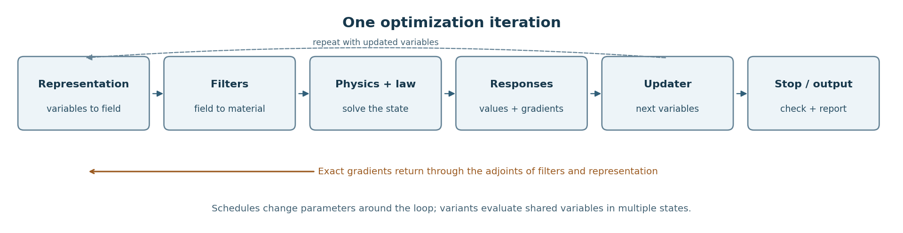

# How Toporia computes a design

A **function** here means a numerical building block, not every Python `def`.
An optimization method can contain several functions; supporting infrastructure
constructs, runs, records or displays them. This guide describes the current
implementation, rather than specifying the GUI colleague's forthcoming network.

## 1. Describe the job

`Run = Scenario + Solver + Output`. The scenario holds the domain, material,
supports, loads, measured objective and limits. The solver chooses functions,
mesh resolution and stopping settings. Output controls saved results and
post-processing. A preset is a recipe for these objects, not a new algorithm.

The current mesh factory produces rectangular Q4 grids or H8 boxes. Element
fields have shape `(nely, nelx)` or `(nelz, nely, nelx)`; a representation's
design variables can have another shape. Coordinates and units are defined by
the scenario; the baseline paper examples use normalized stiffness and forces.

Code: [run.py](../../toporia/framework/problem/run.py),
[scenario.py](../../toporia/framework/problem/scenario.py),
[solver.py](../../toporia/framework/problem/solver.py),
[mesh.py](../../toporia/framework/problem/mesh.py).

## 2. Turn variables into physical material

The representation maps variables to an element field. Filters act in their
declared order. The pipeline then enforces fixed solid/void bounds.

$$
x=R(z),\qquad \rho=P\left(F_m(\cdots F_1(x))\right).
$$

Here $z$ is the optimization variable array, $x$ the represented field,
ρ the physical density, and $P$ the final bound/mask operation. Element
density uses the identity representation. MMC parameters, B-spline coefficients
and neural weights are other kinds of variables. `backward()` returns gradients
with the same shape as those variables.

For the baseline density filter, distance weights average neighboring cells:

$$
\rho_i=\frac{\sum_j H_{ij}x_j}{s_i},\qquad H_{ij}=\max(0,r_{\min}-d_{ij}),\qquad s_i=\sum_j H_{ij}.
$$

The radius is in **elements**, so changing resolution with a fixed radius changes
its physical size. Boundary row sums differ; a normalized forward average is
not generally its own adjoint. Sensitivity filtering is a separate heuristic:
its forward map is identity and its modified gradient is a search direction.

Code: [representation.py](../../toporia/framework/parts/representation.py),
[filter.py](../../toporia/framework/parts/filter.py),
[pipeline.py](../../toporia/plugins/filters/pipeline.py).

## 3. Assign material and solve the state

For linear-elastic SIMP, density sets each element's modulus. Element stiffnesses
are assembled at shared degrees of freedom; the solver handles supports and
solves for free displacements.

$$
E_e=E_{\min}+(E_0-E_{\min})\rho_e^p,\qquad K(\rho)u=f.
$$

$E_0$ is solid modulus, $E_{\min}$ a small void modulus, $p$ the penalty,
$u$ displacement and $f$ applied force. The Q4 element integrates the
strain-displacement and constitutive matrices:

$$
K_e^0=\int_{\Omega_e}B^{\mathsf{T}}D_0B\,t\,\mathrm{d}\Omega.
$$
$B$ maps nodal displacement to strain, $D_0$ is the unit-modulus plane-stress
matrix, and $t$ is thickness. Heat uses a conductivity equation, modes use
stiffness and mass, and nonlinear elasticity solves a residual through Newton
iterations. A generic state can therefore be written as:

$$
\mathcal{R}(u,\rho)=0.
$$

Code: [q4_plane_stress.py](../../toporia/plugins/physics/q4_plane_stress.py),
[simp.py](../../toporia/plugins/interpolations/simp.py),
[physics.py](../../toporia/framework/parts/physics.py).

## 4. Measure responses and differentiate

Responses ask physics for declared features rather than depending on its degree
of freedom numbering. Fixed-load compliance is external work. Smaller compliance
means a stiffer design under that same load. The physical-volume budget for equal
cells is the mean density; some material laws instead define an effective cost.

$$
C=\sum_k w_k f_k^{\mathsf{T}}u_k,\qquad v=\frac{1}{N}\sum_e\rho_e\leq v_{\max}.
$$

$k$ indexes load cases, $w_k$ their weights and $N$ the cell count.
For a general scalar response $J(u,\rho)$, the adjoint avoids differentiating
each displacement with respect to every density:

$$
\left(\frac{\partial\mathcal{R}}{\partial u}\right)^{\mathsf{T}}\lambda=\nabla_u J,\qquad
\nabla_\rho J=\left.\nabla_\rho J\right|_u-\left(\frac{\partial\mathcal{R}}{\partial\rho}\right)^{\mathsf{T}}\lambda.
$$

For fixed-load linear compliance, the adjoint is the displacement itself:

$$
\frac{\partial C}{\partial\rho_e}=-p(E_0-E_{\min})\rho_e^{p-1}\sum_k w_k u_{e,k}^{\mathsf{T}}K_e^0u_{e,k}.
$$

The chain rule carries each exact physical gradient back through the filters and
representation. Here $J_R$ and $J_F$ are Jacobians, not objective values:

$$
\nabla_z J=J_R^{\mathsf{T}}J_{F_1}^{\mathsf{T}}\cdots J_{F_m}^{\mathsf{T}}J_P^{\mathsf{T}}\nabla_\rho J.
$$

Fixed cells have zero derivative through their overwrite. The density filter uses
the transpose with the row normalization on the gradient input. Constraint
responses supply their own values and gradients, normally normalized so a value
at most zero is feasible. Not every updater accepts every objective or constraint.

This exact chain-rule description does not certify every filter variant. The
routing filter floors its volume sensitivity for OC stability, and the Batch 2
audit found a singular saturated-input case in volume-preserving projection.
See the [documented exceptions and evidence](batch-2.md) before treating those
paths as universally exact or differentiable.

Code: [assembled.py](../../toporia/plugins/models/assembled.py),
[response.py](../../toporia/framework/parts/response.py),
[compliance.py](../../toporia/plugins/responses/compliance.py).

## 5. Update, continue and stop

The model returns an `Evaluation`: objective, volume, optional constraints and
their gradients. The updater returns the next variables. Baseline OC uses:

$$
z_e^+=\mathrm{clip}_{[\ell_e,h_e]}\left(z_e\sqrt{\max(0,-g_e/(\mu v_e))}\right).
$$
$g_e$ is the objective direction, $v_e$ the volume gradient and μ the
volume multiplier found by bisection. Bounds ℓ and $h$ include box limits
and the allowed move. OC here requires element-density variables, suitable
gradient signs and a single volume budget. MMA and external optimizers have
different contracts; compatibility is checked before execution.
The optimizer internally uses summed densities with budget $Nv_{\max}$;
dividing both by the cell count gives the mean-density constraint above.

The engine applies explicit schedules before each step. Inside `ComposedMethod`,
the order is **evaluate → advance internal continuation → update → form new
physical density**. A step reports the old design's evaluated objective beside
the new design's density. A fresh final objective therefore needs another solve.
That distinction is retained in the research reports.

$$
\Delta_k=\Vert z^{k+1}-z^k\Vert_\infty.
$$

The ordinary stopping test compares this change to tolerance. Selected nonlinear
representations also monitor physical-density motion. The engine holds stopping
while continuation remains active, can accept a method-specific criterion, and
always applies the iteration cap. Small motion alone proves neither feasibility
nor a globally optimal or binary design. Post-processors then compute diagnostics
or exports; thresholding changes the design and needs its own validation.

Code: [composition.py](../../toporia/framework/parts/composition.py),
[oc.py](../../toporia/plugins/updaters/oc.py),
[loop.py](../../toporia/engine/loop.py),
[postprocess.py](../../toporia/engine/postprocess.py).

## Which functions contain which other functions?

| Container | Current contents | Boundary |
| :-- | :-- | :-- |
| Composed optimization method | One model and one updater | Compatibility is the intersection of their capabilities. |
| Assembled model | Representation, filter pipeline, physics/material law, responses | One evaluation produces values and gradients. |
| Filter chain | Ordered filters | Each intermediate input is retained for the backward pass. |
| Variant model | Several evaluations of the same design under varied settings | A mean or smooth worst case combines values and gradients. |
| Whole method | Its own numerical algorithm and any internal helpers | Existing level-set methods do not necessarily expose the same subfunctions. |
| Run | Scenario, solver and output settings | A job recipe, not an arbitrary executable network. |

## Supporting modules outside numerical-function containment

| Module / area | What it supports |
| :-- | :-- |
| `framework/problem/` | Job descriptions, structured mesh construction, JSON and parameter paths. |
| `framework/params.py` | Parameter defaults, ranges, labels, units and validation. |
| `framework/registry.py` | Discovery, stable plugin names, aliases and optional dependencies. |
| `framework/parts/` | Contracts; abstract interfaces are not additional implemented algorithms. |
| `framework/optimisers/` | Flat-vector adapter, fixed-variable removal, caching and external-loop lifecycle. |
| `engine/pipeline.py` | Compatibility checks and descriptions of selected parts. |
| `engine/loop.py` | Execution, iteration counting, schedules, callbacks and stopping. |
| `engine/records.py` | History, provenance and constraint reports. |
| `apps/` | GUI/CLI interaction, plotting and help presentation. |
| `plugins/problems/` | Preset recipes and research descriptions. |
| Shared/private helpers | Sparse neighborhoods, element assembly and common parameter declarations. |
| `checks/`, `tests/`, `experiments/` | Conformance, regression, independent numerical checks and reproduction evidence. |

These are operational boundaries; a Python helper can still perform mathematics.
The [coverage inventory](coverage.md) enumerates public numerical functions and
engines without counting private helpers or generated model/updater pairings again.
The [complete module map](modules.md) lists every Python module and the numerical
functions it defines, with the remaining files explicitly marked as support or presets.

## Preparing for the GUI framework

Existing keys such as `filter:density` and `model:q4` identify numerical parts;
`Param` already describes settings; capabilities and physics feature contracts
already reject incompatible choices. Keep these as adaptation points. Research
descriptions are plain data and can be reused in a new view without solver changes.

Current assumptions to revisit for larger tasks are structured element-field
shapes, one scalar physical density, mesh-derived supports/loads, and response
features tied to today's engines. Multiple fields, unstructured meshes and
transient states need deliberate interface extensions and numerical validation.
This batch introduces no replacement execution graph or new solver contracts.
