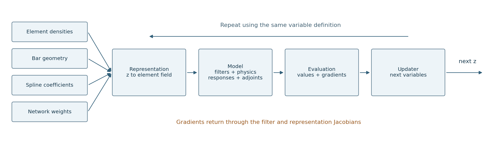
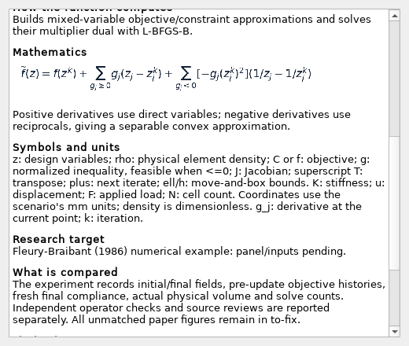

# From design variables to the next design

[Core guide](core.html) · [Batch 3 figures](evidence/batch3/index.html) · [Case index](batch-3-cases.md)

The **representation** defines what can move. The **model** computes what that
movement means physically. The **updater** chooses the next movement.



## The chain rule is the connection

For variables z, representation R, filter chain P and physical compliance C:

$$
\rho=P(R(z)),\quad K(\rho)u=F,\quad C=F^{\mathsf{T}}u
$$

$$
\nabla_z C=J_R(z)^{\mathsf{T}}J_P(R(z))^{\mathsf{T}}\nabla_\rho C
$$

A bar can have five geometric variables; a spline can have 32 coefficients;
a network can have 501 weights and biases. Their sensitivities have those
variable shapes. The finite-element density still has one value per cell.
Taking a density update directly on bar coordinates would violate this map.

| Numerical function | Core computation | Files |
| :-- | :-- | :-- |
| Representation | `setup`, `initial`, `bounds`, `density(z)`, `backward(z, sensitivity)` | [Contract](../../toporia/framework/parts/representation.py), [implementations](../../toporia/plugins/representations/README.md) |
| Assembled model | R, filters, material, state solve, responses, reverse chain | [assembled.py](../../toporia/plugins/models/assembled.py) |
| Evaluation | Objective, volume, their gradients, additional constraints and reported scalars | [model.py](../../toporia/framework/parts/model.py) |
| Updater | `initialize(model, settings)`, `update(z, evaluation, completed)` | [Contract](../../toporia/framework/parts/updater.py), [implementations](../../toporia/plugins/updaters/README.md) |
| Composition | One model and one updater; compatibility checks; update and displayed field | [composition.py](../../toporia/framework/parts/composition.py) |
| Flat view | Free variables, normalization, cached exact gradients and fixed-bound removal | [flat_view.py](../../toporia/framework/optimisers/flat_view.py) |
| External loop | Pauses the library at callbacks; resumes/stops and records its verdict | [external_loop.py](../../toporia/framework/optimisers/external_loop.py) |
| Engine loop | Schedules, step, record, continuation/stop checks, final output | [loop.py](../../toporia/engine/loop.py) |

These last adapters and orchestration modules support functions; they are not
new numerical plugins. The [module map](modules.md) lists them separately.

## How the updater sees the budget

$$
g_0(z)=V(z)/V_* -1\leq0,\quad g_i(z)\leq0
$$

V is the model's budget measure and V* its limit. The flat view supplies this
normalized volume row first, followed by the scenario's extra constraints.
Ordinary SIMP uses physical material volume; SINH can use effective resource
cost instead. A local-stress augmented-Lagrangian response is a penalty with
its own multipliers and must be paired with the updater that understands it.

| Family | What moves the variables | What must be checked |
| :-- | :-- | :-- |
| OC / multi-OC | Multiplicative density ratios and multiplier searches | Gradient signs, physical budget, extra-constraint residuals |
| MMA / GCMMA / CONLIN / CCSAQ | Separable local approximations | Variant, conservative corrections, trial-evaluation counts |
| SiMPL | Logit step plus a volume correction | Normalization and step policy versus the cited SiMPL-A/B |
| Adam / augmented Lagrangians | Moments or inner steps on a penalized objective | Actual constraint violations; small movement is insufficient |
| BESO / TOBS | Ranked or MILP-selected binary switches | Discrete volume, filtered physical density, objective-window stopping |
| SLSQP / trust-constr / null-space | Library constrained steps on the flat view | Library verdict, bounds, active constraints and final physics |
| PTO variant | Material allocation from negative sensitivity | Different allocation/filter ordering from published PTOc |

Specific equations and symbols are in each preset's help and its linked HTML
description. This table is a navigation aid, not a claim that every family
enforces every constraint.



## A displayed step can contain several physics evaluations

```text
engine evaluates current design ─> updater
                                  ├─ optional trial evaluations
                                  ├─ optional conservative corrections
                                  └─ next design ─> display physical field
```

The composed method's recorded objective belongs to the evaluation before its
returned update; displayed density/volume belongs to the returned design.
The Batch 3 driver closes any optimizer thread and then evaluates the final
design again. Its report labels this extra evaluation separately. GCMMA,
line searches and external callbacks can make step counts incomparable.

The three standalone level-set methods evolve their own fields and volume
control. They bypass the composable representation/filter/updater chain and
use linear p=1 ersatz stiffness. Their compliance values should not be ranked
against density methods using p=3 as if only the updater had changed.

## Preparing for nested GUI functions

The current GUI can reuse stable IDs, `Param` definitions, capability checks,
plain research descriptions and the existing forward/backward interfaces.
The descriptions import no GUI code. Adding a new view does not require
changing these numerical functions.

For later execution of nested functions, the hard decisions are shared variable
ownership, field shapes/units, state and derivative lifetimes, cache invalidation
after parameter changes, and how independent branches join their gradients.
The current `VariantModel` combines repeated evaluations of shared variables;
it is a useful reference, not a general multiphysics network. The external-loop
handshake also needs an explicit lifecycle if a future graph owns execution.

No new graph executor, objectives or physics adapters were introduced here.
The GUI effort can plan those boundaries while these documented interfaces
stay available for adaptation.
