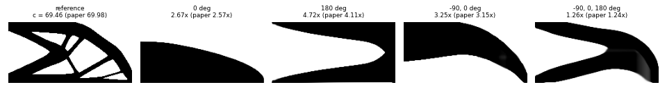

# Published numbers reproduced from open papers

29 October 2026. Each case below builds a run from a paper's stated settings,
using Toporia's own functions, and compares one published number with ours. A
case counts as a match within 5%. The difference is recorded either way.

Only papers with an open HTML full text were used, so the settings could be read
rather than guessed. Paywalled sources (most of the library's references) can't
be read here, and PDF-only preprints can't be parsed without an extra package.
The paper figures themselves are not copied into the repository: arXiv's licence
does not allow redistribution. Each case links to the paper and shows our design.

`python -m experiments.research_papers` reruns everything; evidence is in
[evidence/papers](evidence/papers).

## Ferrari & Sigmund (2020), top99neo, Table 2

The 300 x 100 half-MBB beam, volume 0.5, density filter of radius 8.75 elements,
SIMP p = 3, OC, 2500 steps ([arXiv:2005.05436](https://arxiv.org/abs/2005.05436)).

Paper values: T1 252.7, T2 246.1, T3 199.6. **Not run to completion yet:** the three runs of 2500 steps on 30 000 elements take about four hours together and were stopped. The preset and the recipe are in place; `python -m experiments.research_papers --case top99neo_t3` (likewise t1, t2) produces the comparison.

Toporia's density filter truncates and renormalises its weights at the domain
edge, as top88 does; top99neo mirrors the design there. The paper leaves the OC
move limit to the caller; 0.2 is used. Its own accelerated runs land 1-3% from
the plain ones, so the problem has close local minima.

Preset: **Paper: top99neo Table 2 T3 (MBB)**.

## Hoghoj & Traff (2021), advection-diffusion machining filter, Table 2

The 2 x 1 cantilever on 200 x 100 elements, volume 0.5, density filter of
radius 0.03, MMA ([arXiv:2102.12999](https://arxiv.org/abs/2102.12999)). The
ratios are the compliance relative to the paper's reference design without a
milling constraint.

| Case | Paper | Toporia | Difference | Verdict |
| :-- | --: | --: | --: | :-- |
| [Fig. 5a, no milling (compliance)](evidence/papers/machining_reference/figure.png) | 69.98 | 69.5 | -0.7% | match |
| [Fig. 5b, tool at 0 degrees](evidence/papers/machining_0/figure.png) | 2.57 | 2.67 | +3.9% | match |
| [Fig. 5f, tool at 180 degrees](evidence/papers/machining_180/figure.png) | 4.11 | 4.72 | +14.8% | open |
| [Fig. 6a, tools at -90 and 0 degrees](evidence/papers/machining_m90_0/figure.png) | 3.15 | 3.25 | +3.1% | match |
| [Fig. 6b, tools at -90, 0 and 180 degrees](evidence/papers/machining_m90_0_180/figure.png) | 1.24 | 1.26 | +1.7% | match |

The paper's 0 degree tool reaches from +x (`from_pos_x`), and -90 degrees from
below; this convention was found from the single-tool runs and fits all four
multi-tool cases. The single tool from the left (180 degrees) is 15% stiffer
in the paper. One-tool designs at p = 5 have close local minima, and the
paper's MMA settings and step count are not given. Running 800 steps gives the same 4.72; a move limit of 0.05 gives 5.22. The difference stays open.

Toporia's filter handles tools along the axes only. The paper's oblique tools
(-30, 160 and 240 degrees, and the four diagonals) are left out.

Preset: **Paper: Machining Fig. 6b (cantilever)**.

## Considered and left out

- **SiMPL** (Keith & Surowiec, [arXiv:2411.19421](https://arxiv.org/abs/2411.19421)):
  its compliance values use a load scaling the paper does not state, so only
  ratios would carry over. Toporia's variant grows its step geometrically
  instead of the paper's Armijo or Barzilai-Borwein rules, so step counts are
  not comparable either. The 768 x 256 run is left for a later session.
- **Floating projection** (Huang, arXiv:2006.04306) and **MMC** (Guo et al.,
  arXiv:1404.4820): PDF only.
- **TOuNN**, **AM filter** (Langelaar 2017) and most others: no open full text
  could be read.
