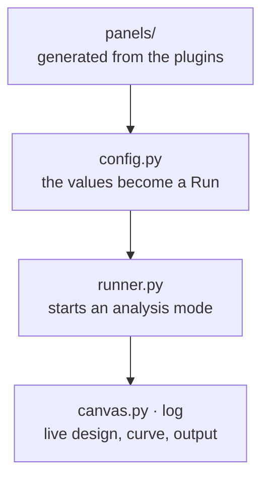

# `toporia_gui` — the desktop app

No optimisation logic: it turns what the person chose into a
[`Run`](../toporia_core/framework/problem/run.py) and hands it to the
[`engine`](../toporia_core/engine/README.md), in a separate process
([`worker.py`](worker.py)) working on a snapshot of the project, so the window stays usable.
The command line is part of the core ([`toporia_core/cli.py`](../toporia_core/cli.py)); with no
command it starts this app, found through the `toporia.apps` entry point.

Home opens projects (and recent ones), the benchmark library, the function explorer and the
documentation. The five steps along the top: Problem (the physical definition, editor and
spatial view), Method (the whole computation as a collapsible tree), Runner, Post-process
(the inspector: every run, every field) and Export. Physical objects are meshed by
`toporia_core/framework/problem/regions.py` and `spatial.py`, so the GUI and the command line use the
same forces and boundary conditions. See [the user workflow](../docs/gui-workflow.md) for
file and interaction details.

```
toporia_gui/
├── desktop.py         the program's entry point: python main.py and Toporia.exe (--worker, --smoke-test)
├── app.py             starts Qt (and sets matplotlib's Qt backend first); splash.py, the loading screen
├── window.py          the main window: the five steps, the panels, Run/Stop
├── project.py         portable project documents; project_ui.py, their file actions and lifecycle
├── home.py            Home: recent projects, the benchmark library, the function explorer, the docs
│                      (function_library.py, docs_view.py)
├── editor.py          the Problem editor in 2-D, with geometry.py (objects, roles, colours) and
│                      geometry_import.py; spatial_view.py, the 3-D editor (VTK)
├── preview.py         the problem drawn before anything is solved; preflight.py, checks before a run
├── method_view.py     the Method step: the whole computation as a collapsible tree; add_function.py
├── workflow_ui.py     keeps the tree and the parameter forms in step
├── config.py          the panels' values → a Run (cheap, so the Pipeline box can refresh)
├── execution.py       runs in a separate process (worker.py) and owns their results; run_window.py,
│                      a run in its own window; runner.py, the bridge to the engine's modes
├── canvas.py          the live design and convergence curve; a truss as bars, a triangle mesh as
│                      triangles, a 3-D design as a density cloud; display_options.py
├── inspect_view.py    the Post-process step: every run, every field (stress, displacement, ...)
├── help.py            the "?" next to every option; research_help.py and research_render.py, the
│                      preset explanations with typeset equations
├── appearance.py      colour schemes; style_maker.py, a style of your own; materials.py, the presets
└── panels/            every input panel, one module each
    ├── method.py          volume, and the method: physics model + updater, or a whole method
    ├── design.py          representation, 2-D or 3-D, resolution and the mesh it gives
    ├── variables.py       the variable space: built-in quantities, your own variables, the fields
    ├── extra_physics.py   more physics on the same design, each with its own material law
    ├── specs.py           filters, objective (objective_terms.py: a combined objective), constraints,
    │                      schedules
    ├── loads.py           load cases
    ├── variants.py        every design in several versions (robust design)
    ├── modes.py           the settings of each analysis mode
    ├── pipeline.py        the Pipeline box
    ├── forms.py           a form generated from Param declarations
    └── common.py          small shared widgets and helpers
```



Every input that comes from a plugin — a method's, filter's or response's parameters,
the list of models, updaters, filters, objectives, constraints — is generated from the
plugin classes, so a new plugin appears in the GUI and the CLI without editing anything
here. A plugin whose optional package is not installed is shown greyed out with the
install command.
